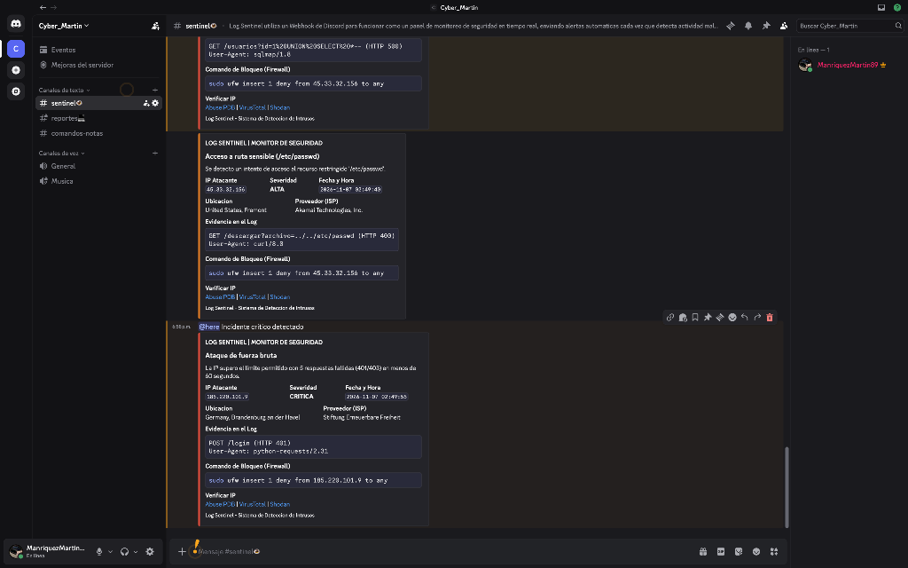
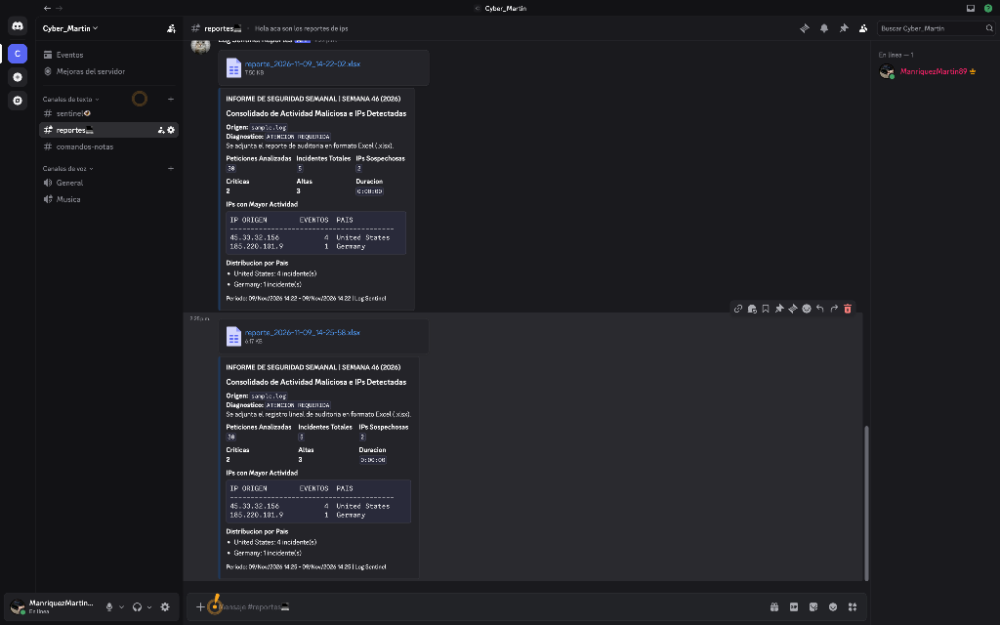

# Log Sentinel

Script en Python para analisis de logs web (formato Nginx / Apache Combined) con deteccion automatizada de reconocimiento, inyeccion SQL, fuerza bruta y generacion de reportes de auditoria hacia Discord y Microsoft Excel.


---

## Descripcion

Log Sentinel es una herramienta modular desarrollada para entornos defensivos (Blue Team / SecOps). Permite procesar registros de acceso de servidores web en lote o mediante monitoreo continuo en vivo (`--live`), evaluando cada solicitud entrante mediante tecnicas de coincidencia de patrones y ventanas temporales de eventos.

El sistema enriquece cada incidente detectado consultando la procedencia geografica y proveedor de red (ISP) de la IP ofensora, alerta de forma inmediata a traves de Webhooks clasificados en Discord y consolida las metricas en un archivo tabular nativo de Excel (`.xlsx`) apto para auditorias de seguridad.

---

## Caracteristicas Principales

- **Parser Estructurado**: Extrae IP de origen, timestamp normalizado, metodo HTTP, URI solicitada, codigo de estado y User-Agent utilizando expresiones regulares compiladas.
- **Deteccion de Reconocimiento e Inyecciones**: Identifica intentos de acceso a archivos de configuracion (`/.env`, `/.git`, `/etc/passwd`), consolas de administracion y firmas comunes de SQL Injection (`union select`, `or 1=1`) o escáneres (`sqlmap`, `nmap`, `gobuster`).
- **Deteccion de Fuerza Bruta**: Correlaciona fallos de autenticacion y accesos restringidos (codigos `401/403`) por direccion IP dentro de una ventana de tiempo deslizante configurable (5 intentos en 60 segundos por defecto).
- **Control de Frecuencia Anti-Spam**: Evita la saturacion del canal de monitoreo aplicando un periodo de gracia de 5 minutos por combinacion de IP y regla antes de reemitir una misma alerta.
- **Threat Intelligence y Geolocalizacion**: Consulta automatica de pais, ciudad e ISP mediante API publica, gestionada con cache en memoria y bypass para rangos privados (RFC 1918).
- **Integracion con Discord (SOC Alerts)**: 
  - Canal `#sentinel`: Alertas en tiempo real con distincion de severidad (`ALTA` en naranja y `CRITICA` en rojo con mencion `@here`), enlaces de verificacion rapida a AbuseIPDB, VirusTotal y Shodan, y comando de bloqueo para UFW listo para copiar.
  - Canal `#reportes`: Resumen consolidado con estadisticas de sesion y adjunto del archivo `.xlsx`.
- **Reportes Ejecutivos en Excel**: Genera un archivo `.xlsx` estructurado de forma lineal con auto-filtros, metadatos y registro cronologico completo de incidentes.
- **Tolerancia a Rotacion de Logs**: En modo en vivo supervisa inodos y tamanos para adaptarse sin interrupciones a eventos de `logrotate` (`rename` y `copytruncate`).
- **Lista Negra Automatizada**: Almacena las IPs atacantes unicas en `ips_bloqueadas.txt` para alimentacion directa de firewalls perimetrales.

---

## Arquitectura de Modulos

```text
Log Sentinel/
├── config.py          # Variables globales, umbrales y firmas de deteccion
├── parser.py          # Modulo de extraccion de campos sobre formato Combined Log
├── detector.py        # Motor de deteccion (patrones estaticos y ventana deslizante)
├── geoip.py           # Cliente de geolocalizacion y enriquecimiento de IPs con cache
├── notifier.py        # Gestion de alertas y comunicacion con Discord Webhooks
├── reporter.py        # Generador de reportes ejecutivos en formato Excel (.xlsx)
├── main.py            # Punto de entrada por linea de comandos (--file y --live)
├── mock_logs.py       # Generador de trafico sintetico (20 legitimos + 10 ataques)
├── requirements.txt   # Dependencias de Python requeridas
└── .env.example       # Plantilla de configuracion para variables de entorno
```

---

## Instalacion y Puesta en Marcha

### 1. Clonar el repositorio y configurar el entorno

```bash
git clone https://github.com/martin8989-dar/log-sentinel.git
cd log-sentinel
python3 -m venv .venv
source .venv/bin/activate
pip install -r requirements.txt
```

### 2. Configurar variables de entorno

Copia la plantilla `.env.example` y define las URLs de los Webhooks de Discord correspondientes:

```bash
cp .env.example .env
```

Contenido del archivo `.env`:

```ini
DISCORD_WEBHOOK_URL=https://discord.com/api/webhooks/...       # Canal de alertas (#sentinel)
DISCORD_WEBHOOK_REPORTES=https://discord.com/api/webhooks/...  # Canal de reportes (#reportes)
```

*(Si no se configuran webhooks, el script operara normalmente mostrando todas las salidas por consola y guardando los archivos locales).*

### 3. Generar datos de prueba y ejecutar

```bash
# Generar archivo de prueba sample.log (20 accesos normales y 10 simulaciones de ataque)
python3 mock_logs.py

# Ejecutar analisis completo por lotes (Batch)
python3 main.py --file sample.log

# Ejecutar en modo monitoreo continuo (Live / tail -f)
python3 main.py --file sample.log --live
```

---

## Evidencia y Salidas del Sistema

### Salida por Terminal

```text
[*] Analizando archivo 'sample.log'...

------------------------------------------------------------
[ALERTA] Acceso a ruta sensible (/.env)
 IP Atacante : 45.33.32.156
 Ubicacion   : United States, Fremont
 ISP         : Akamai Technologies, Inc.
 Fecha/Hora  : 2026-11-07 02:49:34
 Detalles    : Se detecto un intento de acceso al recurso restringido '/.env'.
------------------------------------------------------------
   [ok] Alerta enviado a Discord.

------------------------------------------------------------
[ALERTA] Ataque de fuerza bruta
 IP Atacante : 185.220.101.9
 Ubicacion   : Germany, Brandenburg an der Havel
 ISP         : Stiftung Erneuerbare Freiheit
 Fecha/Hora  : 2026-11-07 02:49:55
 Detalles    : La IP supero el limite permitido con 5 respuestas fallidas (401/403) en menos de 60 segundos.
------------------------------------------------------------
   [lista negra] IP 185.220.101.9 agregada a 'ips_bloqueadas.txt'
   [ok] Alerta enviado a Discord.

[*] Analisis finalizado. Lineas leidas: 30 | Alertas: 5
[*] Reporte en Excel guardado en 'reportes/reporte_2026-11-09_14-25-58.xlsx'
   [ok] Reporte enviado a Discord.
```

### Alertas en Tiempo Real (Canal #sentinel)

Cada vez que el motor detecta una anomalia, despacha de inmediato una tarjeta interactiva (embed) al canal `#sentinel`.



**Detalle de los elementos de la alerta:**
* **Clasificacion visual por severidad**: El borde naranja indica severidad `ALTA` (escaneos de rutas sensibles como `/.env`, `/.git` o `/etc/passwd`), mientras que el borde rojo marca eventos de severidad `CRITICA` (patrones de inyeccion SQL o superacion del umbral de fuerza bruta). En incidentes criticos, se dispara una mencion automatica `@here` para alertar al operador de guardia.
* **Enriquecimiento contextual (Threat Intelligence)**: Muestra en segundos el pais de origen, ciudad y proveedor de internet (ISP) del atacante mediante la integracion con GeoIP.
* **Evidencia forense directa**: Se adjunta la linea exacta del incidente con el metodo HTTP, la URI solicitada, el codigo de respuesta y el `User-Agent`.
* **Respuesta rapida ante incidentes**:
  * **Comando de firewall listo**: Genera la regla exacta de Linux (`sudo ufw insert 1 deny from <IP> to any`) lista para copiar y pegar en la terminal del servidor.
  * **Pivoteo a plataformas de reputacion**: Enlaces directos a **AbuseIPDB**, **VirusTotal** y **Shodan** precargados con la IP para verificar rapidamente el historial del hostil.
  * **Blacklist local**: Cada IP ofensora se almacena automaticamente de forma acumulativa en el archivo `ips_bloqueadas.txt`.

---

### Reporte Ejecutivo y Archivo Excel Adjunto (Canal #reportes)

Al finalizar un lote o cumplirse el ciclo de monitoreo, el modulo de reportes consolida los datos de la sesion y emite un informe estructurado hacia `#reportes`.



**Detalle de los componentes del reporte:**
* **Cabecera ejecutiva y diagnostico**: Identifica el archivo procesado, la semana de operacion y un estado general (`ATENCION REQUERIDA` cuando existen incidentes criticos o `NORMAL`).
* **Panel de metricas consolidadas**:
  * Peticiones totales inspeccionadas.
  * Conteo total de incidentes y numero de IPs hostiles unicas.
  * Desglose proporcional de severidades (`Criticas` vs `Altas`).
  * Tiempo total de procesamiento.
* **Top de amenazas e impacto geografico**:
  * Ranking de las IPs con mayor volumen de intentos hostiles.
  * Distribucion porcentual por pais para identificar origenes recurrentes de trafico malicioso.
* **Adjunto nativo en Microsoft Excel (`.xlsx`)**: El mensaje sube directamente el archivo de auditoria generado con `openpyxl`. El documento incluye formato condicional, auto-filtros, metadatos de sesion y la trazabilidad completa linea por linea para respaldo ante auditorias o presentaciones a gerencia.

---

## Despliegue en Servidores de Produccion (Linux / Nginx)

Para mantener la herramienta activa en segundo plano en un servidor Ubuntu/Debian como servicio del sistema operativo:

### 1. Ubicar el proyecto y configurar permisos

```bash
sudo git clone https://github.com/martin8989-dar/log-sentinel.git /opt/log-sentinel
cd /opt/log-sentinel
sudo python3 -m venv .venv
sudo .venv/bin/pip install -r requirements.txt
sudo cp .env.example .env
sudo chown -R $USER:adm /opt/log-sentinel
```

### 2. Configurar el servicio systemd

Crear el archivo `/etc/systemd/system/log-sentinel.service`:

```ini
[Unit]
Description=Log Sentinel - Servicio de Monitoreo Defensivo
After=network-online.target nginx.service

[Service]
Type=simple
User=root
WorkingDirectory=/opt/log-sentinel
ExecStart=/opt/log-sentinel/.venv/bin/python -u main.py --file /var/log/nginx/access.log --live
Restart=always
RestartSec=5

[Install]
WantedBy=multi-user.target
```

### 3. Iniciar y habilitar el servicio

```bash
sudo systemctl daemon-reload
sudo systemctl enable --now log-sentinel
sudo journalctl -u log-sentinel -f
```

---

## Mitigacion Activa con Firewall

El sistema genera de forma acumulativa el archivo `ips_bloqueadas.txt`. Para aplicar los bloqueos en lote sobre el firewall de Linux (UFW o iptables):

```bash
# Bloqueo masivo mediante UFW
while read ip; do sudo ufw insert 1 deny from "$ip" to any; done < ips_bloqueadas.txt

# Bloqueo masivo mediante iptables
while read ip; do sudo iptables -A INPUT -s "$ip" -j DROP; done < ips_bloqueadas.txt
```

---

## Licencia

Distribuido bajo la Licencia MIT. Consulta el archivo `LICENSE` para mas detalles.

---
**Autor:** Martín Celedón  
**Rol:** Ciberseguridad / Blue Team & Desarrollo Python

